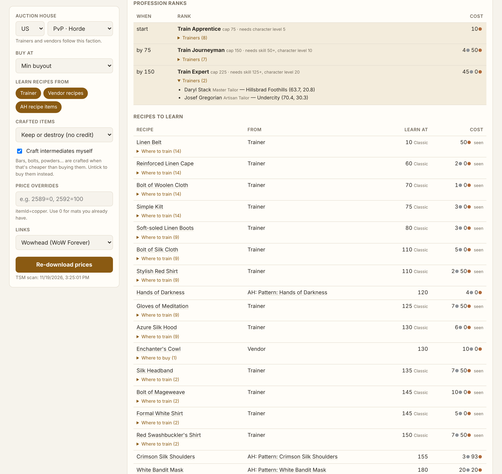

# Cheapest Skill-up

The cheapest way to level a WoW Forever crafting profession to 150, 225, 300 or any skill you choose.
It is priced with [TradeSkillMaster's public pricing data](https://tradeskillmaster.com/public-data)
and includes materials, recipes, trainer fees and profession ranks. It also shows where each trainer
is.

No API key and no dependencies, just Python 3.10+.


| What you need, and the route | Cost breakdown and skill-up chance per step |
|---|---|
|  |  |

| Recipes, ranks and their sources | |
|---|---|
|  | |

| Dark mode | Phone |
|---|---|
|  |  |

## Quick start (Windows PowerShell)

```powershell
git clone -b ccr-8d972126-1vg3tt https://github.com/renori/cheapest-legacy-point.git
cd cheapest-legacy-point
python -m cheapest_skillup.gui
```

This opens http://127.0.0.1:8765/ in your browser. Next time, just double-click `start_gui.bat`.
Always run the commands from inside the folder that contains `cheapest_skillup`.

## Hosted website (GitHub Pages)

The same app also runs as a static website: the planner (`cheapest_skillup/site/planner.js`) runs in the
visitor's browser, and an hourly GitHub Action fetches WoW Forever auction prices from the **Blizzard
Battle.net API** and republishes the site (`.github/workflows/site.yml`).

One-time setup:

1. **Battle.net API client:** at develop.battle.net, *API Access*, create a client (any name; redirect
   URL `http://localhost`). Note its Client ID and Client Secret.
2. **Repository secrets:** in this repo, *Settings → Secrets and variables → Actions → New repository
   secret*: `BLIZZARD_CLIENT_ID` and `BLIZZARD_CLIENT_SECRET`. They're only ever read by the workflow;
   they're never in the code or on the site.
3. **Pages:** *Settings → Pages → Build and deployment → Source: GitHub Actions*. GitHub Pages on a
   free account needs the repository to be **public**; private repositories need a paid plan.
4. Run it: *Actions → Build and publish the site → Run workflow*. After that it runs every hour and on
   every push. The site's address is shown on the run and under *Settings → Pages*.

Forever has no realms: auction houses belong to rulesets, with five Alliance, five Horde and five
neutral (Blackwater) houses per region. Pick yours in the sidebar; trainers and vendors follow its
faction. Prices are each item's cheapest current listing. Blizzard doesn't document Forever's API yet,
so the endpoints may change.

Preview the site locally (prices need your client ID and secret in the environment):

```sh
python -m cheapest_skillup.build_site --out site
python -m cheapest_skillup.blizzard --out site/data/prices --region us
python -m http.server -d site 8000      # then open http://localhost:8000
```

`cheapest_skillup/site/index.html` is generated from `cheapest_skillup/web/index.html` by
`python tools/make_site_page.py`; a test fails if you forget. `tests/test_planner_parity.py` runs the
JavaScript and Python planners on the same data and fails if their routes or totals differ.

## The app

**Overview.** A bar chart with one bar per profession, running from your current skill to 300. Each bar
is split into milestone blocks, shaded light to dark: 1–75 Apprentice, 75–150 Journeyman, 150–225
Expert and 225–300 Artisan. Each block's width is what that stretch costs.
* **Up to 75 / 150 / 225 / 300** draws each bar only as far as that milestone, scaled to the gold it
  costs to get there, so you can compare professions at 150 as easily as at 300. The number on the right
  is the cost to that milestone (and to your own target, if it differs).
* *Same scale* compares professions on one axis; *Full width* shows each profession's own split.
* A line marks your target, and textured blocks lie beyond it.
* Set your skill and target per profession, or click a block to make its end your target.
* Hover a block for its cost and the total from your skill. Star your professions to keep them first.
* *Show as a table* lists every number. Your entries are saved in your browser.

**Profession page.** It opens with **What you need**:
* the total cost and number of crafts;
* the character level the ranks require, and every rank with its cost;
* how many recipes come from trainers, vendors and the AH, with their cost;
* the biggest materials to buy, and what to craft first.

A cost strip follows, then three views:

* **Route:** the recipe to craft for each stretch of skill, with how many crafts and what they cost.
  * Each step shows its colour and skill-up chance at the start and end (for example
    *Orange 100% → Green 26%*).
  * **Click a step** (or its *Details*) to open everything about it in one panel. It starts with how to
    learn the recipe (fee, and a nested *Where to train* / *Where to buy* list), then the costs:
    **per craft, per skill point and for the whole step**, and the step's materials: per craft and in total, the AH listing, what you
    pay and where, and **what a vendor pays you** for it. It also shows the item made, with its AH
    listing, what a vendor pays you for it, and any sell-back credit.
  * Rank rows (*Train Journeyman*, *Learn Expert*, *Quest for Artisan*) appear where you hit each cap,
    with the skill and character level they need.
  * Every trainer step has a **Where to train** list for your auction house's faction: trainer name,
    title, zone and map coordinates, with trainers players have seen in Forever listed first.
  * Steps that need more than 3 crafts per skill point are marked *low chance*.
* **Materials:** the shopping list, intermediates to craft yourself, and tools.
* **Recipes & ranks:** every recipe and rank to learn, where it comes from, its learn level and its
  cost.

Items, recipes, trainers and vendors link to Wowhead. The *Links* setting in the sidebar switches
between Wowhead's WoW Forever and Classic pages.

**Sidebar.** Here you choose your auction house (region, Normal or PvP, faction), which TSM price to buy
at, whether to buy recipe items on the AH, what to do with crafted items (keep, sell to a vendor, or
sell on the AH after the 5% cut and deposit), and per-item price overrides (`2589=0` for mats you
already have).

The server listens only on `127.0.0.1`, so only your computer can reach it. Stop it with Ctrl+C.

## Command line

```sh
python -m cheapest_skillup tailoring                       # one profession, 1 -> 150
python -m cheapest_skillup tailoring --to 300              # to Artisan
python -m cheapest_skillup leatherworking --from 120 --to 225
python -m cheapest_skillup                                 # all professions, plus a summary
python -m cheapest_skillup alchemy --region eu --realm normal-alliance
python -m cheapest_skillup cooking --sources trainer       # don't buy recipe items
python -m cheapest_skillup cooking --sources trainer,vendor  # vendor recipes, but not from the AH
python -m cheapest_skillup tailoring --sell-back           # credit the vendor value of what you craft
python -m cheapest_skillup tailoring --sell-back ah        # ...or its AH value (optimistic)
python -m cheapest_skillup tailoring --price marketValue   # if min buyouts are thin
python -m cheapest_skillup tailoring --json
```

Professions: `alchemy`, `blacksmithing`, `cooking`, `enchanting`, `engineering`, `first_aid`,
`leatherworking`, `tailoring`.

## Prices

Prices are downloaded from `https://public-data.tradeskillmaster.com` and cached for 3 hours in
`~/.cache/cheapest-skillup` (*Re-download prices* in the app, `--refresh` on the command line).

| Option     | Default     | Meaning |
|------------|-------------|---------|
| `--region` | `us`        | `us` or `eu` |
| `--realm`  | `pvp-horde` | Forever auction house: `normal-alliance`, `normal-horde`, `pvp-alliance`, `pvp-horde` |
| `--price`  | `minBuyout` | TSM column to buy at: `minBuyout`, `marketValue`, `recent`, `historical` |

For each reagent, in this order:

1. The vendor price: the cheapest vendor on your faction or a neutral one, per item (a stack of 5 Empty
   Vials for 20c is 4c each), from ForeverDB's vendor data. **Stock a vendor has only in limited supply
   is never used**, for materials or for vendor recipes. An item a vendor on your side sells in unlimited
   supply (dyes, threads, flux, vials, spices…) is always bought from the vendor, even when one AH listing
   is cheaper: that listing rarely covers the quantity a route needs.
2. Otherwise the auction-house price, or the region market value if nothing is listed.
3. Crafting it yourself, when that's cheaper (for example, Rough Blasting Powder from Rough Stone at 6c
   against 14c on the AH). The cost breakdown shows what a crafted material is made from. Untick
   *Craft intermediates myself* (`--buy-intermediates`) to buy them instead.

## How the route is chosen

Skill-up chance at skill `s` (the WoW formula):

| Recipe colour | Skill | Chance |
|---|---|---|
| Orange | below yellow | 100% |
| Yellow → green | yellow to grey | `(grey − s) / (grey − yellow)`, falling in a straight line |
| Grey | grey and above | 0% |

A point therefore takes `1 / chance` crafts on average and costs `craft cost / chance`. When choosing
recipes, a craft that makes a profit when sold counts as free, never better than free, and each craft
carries 5c of effort. That way the route doesn't grind a profitable recipe at a 3% chance. Reported costs
stay the real ones, profit included. For example,
Linen Belt is 100% until 50, 50% at 67 and 26% at 76, which is why a route moves on to another recipe
once the current one gets dear per point. The cheapest recipe is picked for every point.

The raw choice is then refined:

* **No zigzag.** A run of 1–2 points with a different recipe is folded into its neighbour's recipe
  when that costs at most 1s (or 0.5% of materials) more.
* **Paid recipes must pay off.** For each recipe that costs something (a trainer fee or an AH recipe
  item), the tool estimates the cost of doing its points with the next-best recipe. If that is
  cheaper than learning the recipe, the route is re-planned without it, and the change is kept only if
  the total really drops.
* **Ranks.** The fee of every profession rank on the way is added (Journeyman 4s 50c, Expert 45s,
  Artisan 4g 50s or 5g, depending on the profession). First Aid and Cooking Expert are skill books,
  priced at the cheaper of vendor and AH. First Aid and Cooking Artisan come from quests.

Quantities are expected values, so buy a little extra. Min buyout is the cheapest single listing, so
large orders cost more; compare against `--price marketValue`. Not modelled: skill-ups from crafting
intermediates (so the estimate errs high), the items you enchant, and the AH order book.

## Data

| File | What | Source | Refresh with |
|------|------|--------|--------------|
| `data/recipes/*.json` | Every craft: reagents, product, skill colours, tools | WoW Forever client tables via [wago.tools](https://wago.tools) | `python -m cheapest_skillup.gamedata` |
| `data/vendor_sell.json`, `data/item_names.json` | What a vendor pays you for every item the recipes use or make; item names | same | same |
| `data/foreverdb.json` | How each recipe is learned, trainer fees seen in Forever, rank fees, trainer locations, NPC names | [ForeverDB.net](https://foreverdb.net) addon data | `python -m cheapest_skillup.foreverdb` |
| `data/foreverdb_api.json` | Per recipe: vendors and their prices, trainers per faction, fees, learn levels (numbers and ids only) | [ForeverDB API](https://foreverdb.net/developers) | `python -m cheapest_skillup.foreverdb_api` (needs a key) |
| `data/trainer_classic.json` | Classic trainer fees and learn levels, used where nothing better is known | [CMaNGOS classic-db](https://github.com/cmangos/classic-db) | `python -m cheapest_skillup.classic_trainers <dump>` |
| `data/trainer.json` | **Your own** trainer fees, learn levels and exclusions | you | |

### How recipes are learned

| Learn       | Meaning | Cost counted |
|-------------|---------|--------------|
| `Known`     | Learned with the profession | free |
| `Trainer`   | Taught by a profession trainer | its fee |
| `Vendor recipe` | A recipe item sold by a vendor on your faction | the vendor's price |
| `AH recipe` | A recipe item bought on the AH (Pattern:, Recipe:, Plans:...) | that item's price on your AH |

* A recipe item is used only if a vendor on your faction sells it or it's listed on your auction house,
  whichever is cheaper. Vendors whose price includes something other than gold (Merchant's Favor) are
  skipped.
* Recipes taught only by bind-on-pickup items (quest rewards, BoP drops) are left out. So are recipes
  with no known source, and recipes ForeverDB marks as probably not in the live game.
* For trainer fees and learn levels, priority goes: your `trainer.json`, then ForeverDB (fees seen at
  Forever trainers, shown as *seen*), then Classic values (shown as `~` or *Classic*). Otherwise the fee
  counts as 0 and the learn level is assumed to be the recipe's yellow level (*est.*).

### The ForeverDB API (optional) and your key

The committed `data/foreverdb_api.json` was made with an API key, so you don't need one to use the tool.
To refresh it yourself:

```powershell
$env:FOREVERDB_API_KEY = "fdb_..."        # your key, for this PowerShell window only
python -m cheapest_skillup.foreverdb_api
Remove-Item Env:FOREVERDB_API_KEY
```

The key is read only from that environment variable, sent only to foreverdb.net, and never printed or
written to a file. The API's text is watermarked to the key that fetched it, so the importer keeps only
numbers, ids, coordinates and flags: no names or descriptions. It also refuses to write data that
contains hidden characters or the key. `tests/test_no_secrets.py` fails if anything key-like or
watermarked is ever committed. Never put the key in a file in this folder; `.gitignore` also blocks
`.env` and `*.key` files.

### Your corrections: `data/trainer.json`

```json
"2385": {"name": "Brown Linen Vest", "profession": "Tailoring", "cost": 50, "learn": 10},
"12345": {"exclude": true},
```

`cost` is in copper (1s 25c = `125`), `learn` is the skill needed to train it, and `"exclude": true`
removes a recipe you can't get. Rank fees can be overridden too, with
`"ranks": {"tailoring": {"300": {"cost": 50000}}}`. Re-running the importers keeps what you entered.

## Credits

* Prices: [TradeSkillMaster](https://tradeskillmaster.com/public-data) public pricing data.
* Game data: WoW Forever client tables via [wago.tools](https://wago.tools). World of Warcraft is a
  trademark of Blizzard Entertainment. This tool is not affiliated with Blizzard.
* Recipe sources, trainer fees, vendor prices, ranks and trainer/vendor locations: **Data from
  ForeverDB.net (https://foreverdb.net)**, addon data under GPL-3.0 with attribution, and the ForeverDB
  API.
* Classic trainer estimates: [CMaNGOS classic-db](https://github.com/cmangos/classic-db), GPL-3.0.

## Tests

```sh
python -m unittest
```
