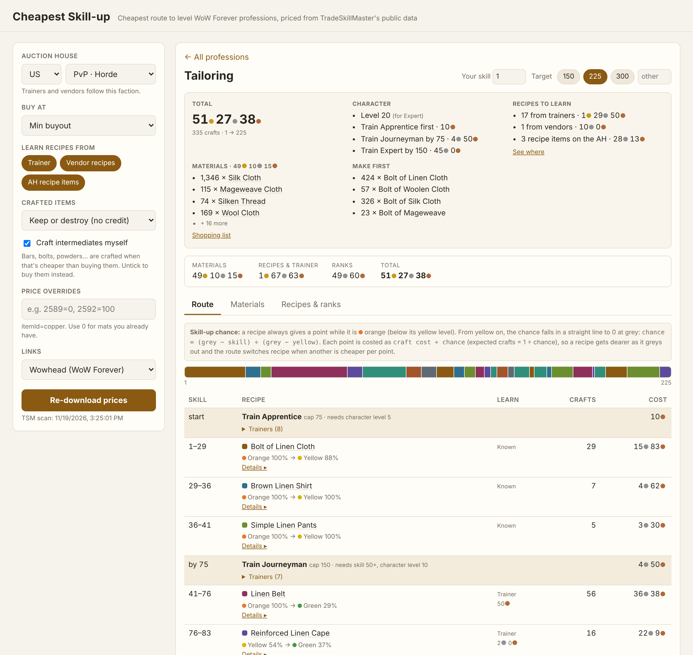

# Cheapest Skill-up

The cheapest way to level a WoW Forever crafting profession to 150, 225, 300 or any skill you choose.
It is priced with [TradeSkillMaster's public pricing data](https://tradeskillmaster.com/public-data)
and includes materials, recipes, trainer fees and profession ranks. It also shows where each trainer
is.

No API key and no dependencies, just Python 3.10+.


| Route with ranks and trainer locations | Recipes, ranks and their sources |
|---|---|
|  |  |

| Dark mode | Phone |
|---|---|
|  |  |

## Quick start (Windows PowerShell)

```powershell
git clone -b ccr-8d972126-1vg3tt https://github.com/renori/cheapest-legacy-point.git
cd cheapest-legacy-point
python -m cheapest_skillup.gui
```

This opens http://127.0.0.1:8765/ in your browser. Next time, just double-click `start_gui.bat`.
Always run the commands from inside the folder that contains `cheapest_skillup`.

## The app

**Overview.** There is one card per profession. Enter your current skill and pick a target: 150, 225,
300, or any other number. The card shows the cost from your skill to each milestone, with your target
highlighted. Star your own professions to keep them at the top. Your entries are saved in your browser.

**Profession page.** It opens with a cost summary: materials, anything you recover by selling, recipes
and trainer fees, profession ranks and tools. Below it are three views:

* **Route:** the recipe to craft for each stretch of skill, with how many crafts and what they cost.
  * Rank rows (*Train Journeyman*, *Learn Expert*, *Quest for Artisan*) appear where you hit each cap,
    with the skill and character level they need.
  * Every trainer step has a **Where to train** list for your auction house's faction: trainer name,
    title, zone and map coordinates, with trainers players have seen in Forever listed first.
  * Steps that need more than 3 crafts per skill point are marked *low chance*.
* **Materials:** the shopping list, intermediates to craft yourself, and tools.
* **Recipes & ranks:** every recipe and rank to learn, where it comes from, its learn level and its
  cost.

**Sidebar.** Here you choose your auction house (region, Normal or PvP, faction), which TSM price to buy
at, whether to buy recipe items on the AH, what to do with crafted items (keep, sell to a vendor, or
sell on the AH after the 5% cut and deposit), and per-item price overrides (`2589=0` for mats you
already have).

The server listens only on `127.0.0.1`, so only your computer can reach it. Stop it with Ctrl+C.

## Command line

```sh
python -m cheapest_skillup tailoring                       # one profession, 1 -> 150
python -m cheapest_skillup tailoring --to 300              # to Artisan
python -m cheapest_skillup leatherworking --from 120 --to 225
python -m cheapest_skillup                                 # all professions, plus a summary
python -m cheapest_skillup alchemy --region eu --realm normal-alliance
python -m cheapest_skillup cooking --sources trainer       # don't buy recipe items
python -m cheapest_skillup tailoring --sell-back           # credit the vendor value of what you craft
python -m cheapest_skillup tailoring --sell-back ah        # ...or its AH value (optimistic)
python -m cheapest_skillup tailoring --price marketValue   # if min buyouts are thin
python -m cheapest_skillup tailoring --json
```

Professions: `alchemy`, `blacksmithing`, `cooking`, `enchanting`, `engineering`, `first_aid`,
`leatherworking`, `tailoring`.

## Prices

Prices are downloaded from `https://public-data.tradeskillmaster.com` and cached for 3 hours in
`~/.cache/cheapest-skillup` (*Re-download prices* in the app, `--refresh` on the command line).

| Option     | Default     | Meaning |
|------------|-------------|---------|
| `--region` | `us`        | `us` or `eu` |
| `--realm`  | `pvp-horde` | Forever auction house: `normal-alliance`, `normal-horde`, `pvp-alliance`, `pvp-horde` |
| `--price`  | `minBuyout` | TSM column to buy at: `minBuyout`, `marketValue`, `recent`, `historical` |

For each reagent, the tool uses the cheapest of these:

1. The auction-house price, or the region market value if nothing is listed.
2. The vendor price from `data/vendor_items.json`. A vendor-sold item is bought on the AH only if it's
   at least 10% cheaper there.
3. Crafting it yourself with a recipe from the same profession (for example, Bolt of Linen Cloth).

## How the route is chosen

At skill `s`, a recipe skills up with probability 1 below its yellow level,
`(grey − s) / (grey − yellow)` from yellow to grey, and 0 from grey on. The expected cost of one point
is `craft cost / probability`, and the cheapest recipe is picked for every point.

The raw choice is then refined:

* **No zigzag.** A run of 1–2 points with a different recipe is folded into its neighbour's recipe
  when that costs at most 1s (or 0.5% of materials) more.
* **Paid recipes must pay off.** For each recipe that costs something (a trainer fee or an AH recipe
  item), the tool estimates the cost of doing its points with the next-best recipe. If that is
  cheaper than learning the recipe, the route is re-planned without it, and the change is kept only if
  the total really drops.
* **Ranks.** The fee of every profession rank on the way is added (Journeyman 4s 50c, Expert 45s,
  Artisan 4g 50s or 5g, depending on the profession). First Aid and Cooking Expert are skill books,
  priced at the cheaper of vendor and AH. First Aid and Cooking Artisan come from quests.

Quantities are expected values, so buy a little extra. Min buyout is the cheapest single listing, so
large orders cost more; compare against `--price marketValue`. Not modelled: skill-ups from crafting
intermediates (so the estimate errs high), the items you enchant, and the AH order book.

## Data

| File | What | Source | Refresh with |
|------|------|--------|--------------|
| `data/recipes/*.json` | Every craft: reagents, product, skill colours, tools | WoW Forever client tables via [wago.tools](https://wago.tools) | `python -m cheapest_skillup.gamedata` |
| `data/vendor_sell.json`, `data/item_names.json` | Vendor sell prices, item names | same | same |
| `data/foreverdb.json` | How each recipe is learned, trainer fees seen in Forever, rank fees, trainer locations | [ForeverDB.net](https://foreverdb.net) addon data | `python -m cheapest_skillup.foreverdb` |
| `data/trainer_classic.json` | Classic trainer fees and learn levels, used where nothing better is known | [CMaNGOS classic-db](https://github.com/cmangos/classic-db) | `python -m cheapest_skillup.classic_trainers <dump>` |
| `data/trainer.json` | **Your own** trainer fees, learn levels and exclusions | you | |

### How recipes are learned

| Learn       | Meaning | Cost counted |
|-------------|---------|--------------|
| `Known`     | Learned with the profession | free |
| `Trainer`   | Taught by a profession trainer | its fee |
| `AH recipe` | Taught by a recipe item (Pattern:, Recipe:, Plans:...) | that item's price on your AH |

* A recipe item is used only if it's listed on your auction house.
* Recipes taught only by bind-on-pickup items (quest rewards, BoP drops) are left out. So are recipes
  with no known source, and recipes ForeverDB marks as probably not in the live game.
* For trainer fees and learn levels, priority goes: your `trainer.json`, then ForeverDB (fees seen at
  Forever trainers, shown as *seen*), then Classic values (shown as `~` or *Classic*). Otherwise the fee
  counts as 0 and the learn level is assumed to be the recipe's yellow level (*est.*).

### Your corrections: `data/trainer.json`

```json
"2385": {"name": "Brown Linen Vest", "profession": "Tailoring", "cost": 50, "learn": 10},
"12345": {"exclude": true},
```

`cost` is in copper (1s 25c = `125`), `learn` is the skill needed to train it, and `"exclude": true`
removes a recipe you can't get. Rank fees can be overridden too, with
`"ranks": {"tailoring": {"300": {"cost": 50000}}}`. Re-running the importers keeps what you entered.

## Credits

* Prices: [TradeSkillMaster](https://tradeskillmaster.com/public-data) public pricing data.
* Game data: WoW Forever client tables via [wago.tools](https://wago.tools). World of Warcraft is a
  trademark of Blizzard Entertainment. This tool is not affiliated with Blizzard.
* Recipe sources, trainer fees, ranks and trainer locations: **Data from ForeverDB.net
  (https://foreverdb.net)**, GPL-3.0 with attribution.
* Classic trainer estimates: [CMaNGOS classic-db](https://github.com/cmangos/classic-db), GPL-3.0.

## Tests

```sh
python -m unittest
```
