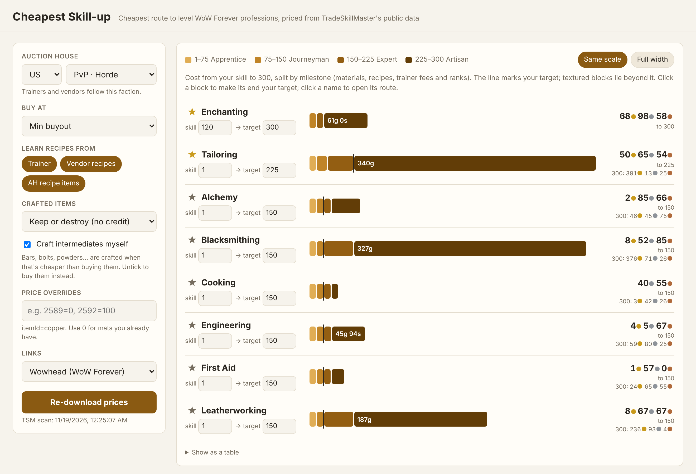
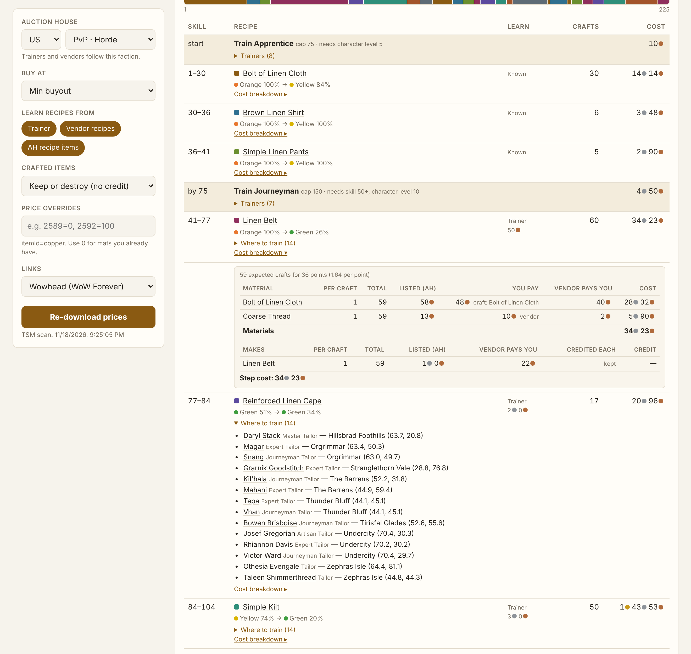
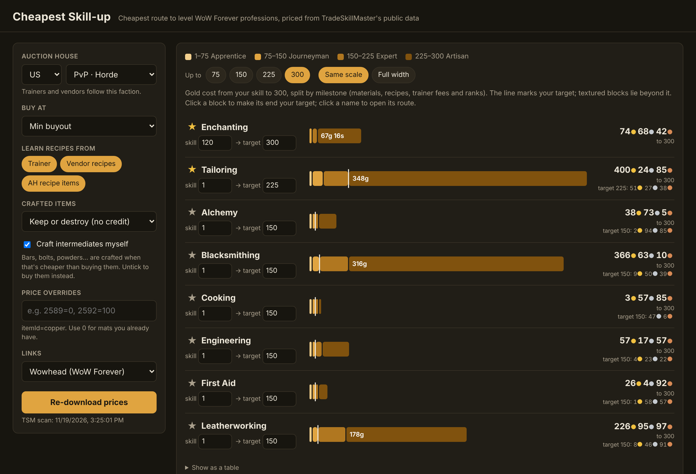
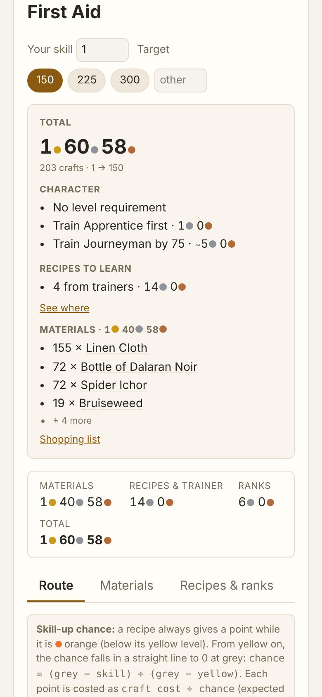

# Cheapest Skill-up

The cheapest way to level a WoW Forever crafting profession to 150, 225, 300 or any skill you choose,
priced with live auction house data from the Blizzard Battle.net API. It counts materials, recipes,
trainer fees and profession ranks, and shows where each trainer and vendor is.

It's a static website: an hourly GitHub Action fetches prices and publishes the site to GitHub Pages,
and the planner runs in your browser.

**Site:** https://renori.github.io/cheapest-legacy-point/



| What you need, and the route | Cost breakdown and skill-up chance per step |
|---|---|
|  |  |

| Recipes, ranks and their sources | |
|---|---|
|  | |

| Dark mode | Phone |
|---|---|
|  |  |

The screenshots come from the earlier local app; the site looks the same apart from the auction house
picker.

## Using the site

**Sidebar.** Pick your region, **ruleset** and **auction house** (Alliance, Horde or Blackwater).
Trainers and vendors follow the house's faction. Then choose:
* where recipes may come from (trainers, vendor recipes, recipe items on the AH);
* what to do with crafted items: keep them, sell to a vendor, or sell on the AH after the 5% cut and
  deposit;
* whether to craft intermediates yourself when that's cheaper;
* per-item price overrides (`2589=0` for mats you already have);
* whether links go to Wowhead's WoW Forever or Classic pages.

*Reload prices* fetches the latest hourly prices. Your settings are saved in your browser.

**Overview.** A bar chart with one bar per profession, from your current skill to 300. Each bar is split
into milestone blocks, shaded light to dark: 1–75 Apprentice, 75–150 Journeyman, 150–225 Expert and
225–300 Artisan. Each block's width is what that stretch costs.
* **Up to 75 / 150 / 225 / 300** draws each bar only as far as that milestone, scaled to the gold it
  costs to get there. The number on the right is the cost to that milestone (and to your own target, if
  it differs).
* *Same scale* compares professions on one axis; *Full width* shows each profession's own split.
* A line marks your target, and textured blocks lie beyond it.
* Set your skill and target per profession, or click a block to make its end your target. Star your
  professions to keep them first. *Show as a table* lists every number.

**Profession page.** It opens with **What you need**: the total cost and number of crafts, the ranks
and the character level they need, the recipes to learn and their cost, the biggest materials to buy and
what to craft first. Then three views:

* **Route:** the recipe to craft for each stretch of skill, with how many crafts and what they cost.
  * Each step shows its colour and skill-up chance at the start and end (for example
    *Orange 100% → Green 26%*). Steps that need more than 3 crafts per point are marked *low chance*.
  * **Click a step** to open how to learn the recipe (fee, and a nested *Where to train* / *Where to
    buy*), its cost **per craft, per skill point and for the whole step**, and each material: per craft
    and in total, its AH listing, what you pay and where, and what a vendor pays you for it.
  * Rank rows (*Train Journeyman*, *Learn Expert*, *Quest for Artisan*) appear where you hit each cap.
  * *Where to train* lists trainers for your faction with zone and map coordinates, those seen in
    Forever first.
* **Materials:** the shopping list, intermediates to craft yourself, and tools.
* **Recipes & ranks:** every recipe and rank to learn, where it comes from, its learn level and cost.

Items, recipes, trainers and vendors link to Wowhead.

## Auction houses and rulesets

Forever has no realms. The API lists four rulesets in US and EU (1 PvP, 2 Normal, 3 Roleplay,
15 Roleplay PvP) and 15 auction houses per region, in sets of one Alliance, one Horde and one Blackwater
house. Each house has its own listings and prices.

The API doesn't say which ruleset a house belongs to: every ruleset lists all 15 houses, a house returns
the same auctions whichever ruleset you ask through, and its `ruleset` field just echoes the request.
The site infers it from the house IDs:

| Houses (Alliance / Horde / Blackwater) | Inferred ruleset | Why |
|---|---|---|
| 110 / 113 / 116 | PvP | first set; one of the two busy ones |
| 111 / 114 / 117 | Normal | second set; one of the two busy ones |
| 112 / 115 / 118 | — | no auctions (a ruleset not live yet); hidden |
| 119 / 120 / 121 | Roleplay | added later; one of the two quiet ones |
| 123 / 124 / 125 | Roleplay PvP | added last; one of the two quiet ones |

The busy pair is clearly PvP and Normal and the quiet pair Roleplay and Roleplay PvP; the order within
each pair assumes the houses were created in ruleset-ID order. If Blizzard starts saying which ruleset a
house belongs to, the fetcher uses that instead (`assign_rulesets` in `cheapest_skillup/blizzard.py`).

Prices are each item's cheapest current buyout (per item) and the quantity listed, from both the
regular auctions and the commodities endpoint.

## How prices are used

For each material, in this order:

1. **Vendor.** The cheapest vendor on your faction or a neutral one, per item (a stack of 5 Empty Vials
   for 20c is 4c each), from ForeverDB's vendor data. An item a vendor sells in unlimited supply (dyes,
   threads, flux, vials, spices…) is always bought there, even when one AH listing is cheaper. **Stock a
   vendor has only in limited supply is never used**, for materials or recipes.
2. **Auction house:** the cheapest current buyout on your house.
3. **Craft it yourself** when that's cheaper (for example Rough Blasting Powder from Rough Stone). The
   cost breakdown shows what a crafted material is made from.

## How the route is chosen

Skill-up chance at skill `s` (the WoW formula):

| Recipe colour | Skill | Chance |
|---|---|---|
| Orange | below yellow | 100% |
| Yellow → green | yellow to grey | `(grey − s) / (grey − yellow)`, falling in a straight line |
| Grey | grey and above | 0% |

A point takes `1 / chance` crafts on average and costs `craft cost / chance`. The cheapest recipe is
picked for every point. When choosing, a craft that makes a profit when sold counts as free (never
better), and each craft carries 5c of effort, so the route doesn't grind a profitable recipe at a 3%
chance. Reported costs stay the real ones, profit included.

The choice is then refined:

* **No zigzag.** A run of 1–2 points with a different recipe is folded into its neighbour's when that
  costs at most 1s (or 0.5% of materials) more.
* **Paid recipes must pay off.** For each recipe that costs something (a trainer fee or a recipe item),
  the planner re-plans without it and keeps that only if the total really drops.
* **Ranks.** Every rank fee on the way is added. First Aid and Cooking Expert are skill books, priced
  like any item. First Aid and Cooking Artisan come from quests.

Quantities are expected values, so buy a little extra. The cheapest listing may not cover a large order.
Not modelled: skill-ups from crafting intermediates (so the estimate errs high) and the items you enchant.

## Hosting it yourself (GitHub Pages)

1. **Battle.net API client:** at develop.battle.net, *API Access*, create a client (any name; redirect
   URL `http://localhost`). Note its Client ID and Client Secret.
2. **Repository secrets:** *Settings → Secrets and variables → Actions → New repository secret*:
   `BLIZZARD_CLIENT_ID` and `BLIZZARD_CLIENT_SECRET`. Only the workflow reads them; they're never in the
   code or on the site.
3. **Pages:** *Settings → Pages → Build and deployment → Source: GitHub Actions*. On a free account
   the repository must be **public**.
4. *Actions → Build and publish the site → Run workflow*. After that it runs every hour (at :17) and on
   every push (`.github/workflows/site.yml`): tests, build, price fetch, publish.

Preview locally (prices need your client ID and secret in the environment):

```sh
python -m cheapest_skillup.build_site --out site
python -m cheapest_skillup.blizzard --out site/data/prices --region us
python -m http.server -d site 8000      # then open http://localhost:8000
```

Python 3.10+ builds the data and fetches prices; Node.js 18+ runs the planner tests. No other
dependencies.

## Code

| Path | What |
|---|---|
| `cheapest_skillup/site/index.html` | The website (one page) |
| `cheapest_skillup/site/planner.js` | The planner: prices, skill-up chances, route, learn costs, ranks |
| `cheapest_skillup/build_site.py` | Builds the site and its data files (`data/professions.json`, `items.json`, `npcs.json`) |
| `cheapest_skillup/blizzard.py` | Fetches every auction house's prices from the Battle.net API |
| `cheapest_skillup/recipes.py` | Loads and merges the recipe, trainer, rank and vendor data |
| `cheapest_skillup/gamedata.py`, `foreverdb.py`, `foreverdb_api.py`, `classic_trainers.py` | Importers (see *Data*) |
| `tests/` | Python tests for the data and the fetcher; `planner.test.mjs` unit-tests the planner, and `test_planner.py` also checks 32 routes against `planner_snapshot.json` |
| `archive/python-app/` | The original local app (Python planner, CLI and GUI, TSM prices). Archived, not maintained |

Run all tests with `python -m unittest` (it runs the JavaScript tests too when Node.js is installed).
If you change the planner on purpose, re-record the route snapshot:
`UPDATE_PLANNER_SNAPSHOT=1 python -m unittest tests.test_planner`.

## Data

| File | What | Source | Refresh with |
|------|------|--------|--------------|
| `data/recipes/*.json` | Every craft: reagents, product, skill colours, tools | WoW Forever client tables via [wago.tools](https://wago.tools) | `python -m cheapest_skillup.gamedata` |
| `data/vendor_sell.json`, `data/item_names.json` | What a vendor pays you for every item the recipes use or make; item names | same | same |
| `data/foreverdb.json` | How each recipe is learned, trainer fees seen in Forever, rank fees, trainer and vendor locations, vendor stock | [ForeverDB.net](https://foreverdb.net) addon data | `python -m cheapest_skillup.foreverdb` |
| `data/foreverdb_api.json` | Per recipe: vendors and their prices, trainers per faction, fees, learn levels (numbers and ids only) | [ForeverDB API](https://foreverdb.net/developers) | `python -m cheapest_skillup.foreverdb_api` (needs a key) |
| `data/trainer_classic.json` | Classic trainer fees and learn levels, used where nothing better is known | [CMaNGOS classic-db](https://github.com/cmangos/classic-db) | `python -m cheapest_skillup.classic_trainers <dump>` |
| `data/trainer.json` | **Your own** trainer fees, learn levels and exclusions | you | |

After refreshing data, push: the site rebuilds from it.

### How recipes are learned

| Learn       | Meaning | Cost counted |
|-------------|---------|--------------|
| `Known`     | Learned with the profession | free |
| `Trainer`   | Taught by a profession trainer | its fee |
| `Vendor recipe` | A recipe item sold by a vendor on your faction | the vendor's price |
| `AH recipe` | A recipe item bought on the AH (Pattern:, Recipe:, Plans:...) | its price on your AH |

* A recipe item is used only if a vendor on your faction sells it or it's listed on your auction house,
  whichever is cheaper. Vendors whose price includes something other than gold are skipped.
* Recipes taught only by bind-on-pickup items (quest rewards, BoP drops) are left out, as are recipes
  with no known source and recipes ForeverDB marks as probably not in the live game.
* Trainer fees and learn levels: your `trainer.json` first, then ForeverDB (fees seen at Forever
  trainers), then Classic values. Otherwise the fee counts as 0 and the learn level is assumed to be
  the recipe's yellow level (*est.*).

### Your corrections: `data/trainer.json`

```json
"2385": {"name": "Brown Linen Vest", "profession": "Tailoring", "cost": 50, "learn": 10},
"12345": {"exclude": true},
```

`cost` is in copper (1s 25c = `125`), `learn` is the skill needed to train it, and `"exclude": true`
removes a recipe you can't get. Rank fees can be overridden too, with
`"ranks": {"tailoring": {"300": {"cost": 50000}}}`. Re-running the importers keeps what you entered.

### API keys

The Battle.net client ID and secret live only in the repository's Actions secrets. The ForeverDB key is
needed only to refresh `data/foreverdb_api.json`:

```powershell
$env:FOREVERDB_API_KEY = "fdb_..."        # your key, for this PowerShell window only
python -m cheapest_skillup.foreverdb_api
Remove-Item Env:FOREVERDB_API_KEY
```

Keys are read only from environment variables and never printed or written to a file. The ForeverDB
API's text is watermarked to the key that fetched it, so the importer keeps only numbers, ids,
coordinates and flags, and refuses to write hidden characters or the key. `tests/test_no_secrets.py`
fails if anything key-like or watermarked is ever committed; `.gitignore` also blocks `.env` and
`*.key` files.

## Credits

* Prices: Blizzard Battle.net API.
* Game data: WoW Forever client tables via [wago.tools](https://wago.tools). World of Warcraft is a
  trademark of Blizzard Entertainment. This tool is not affiliated with Blizzard.
* Recipe sources, trainer fees, vendor prices, ranks and trainer/vendor locations: **Data from
  ForeverDB.net (https://foreverdb.net)**, addon data under GPL-3.0 with attribution, and the ForeverDB
  API.
* Classic trainer estimates: [CMaNGOS classic-db](https://github.com/cmangos/classic-db), GPL-3.0.
* Earlier versions used [TradeSkillMaster](https://tradeskillmaster.com/public-data) public pricing
  data (the archived app still does).
